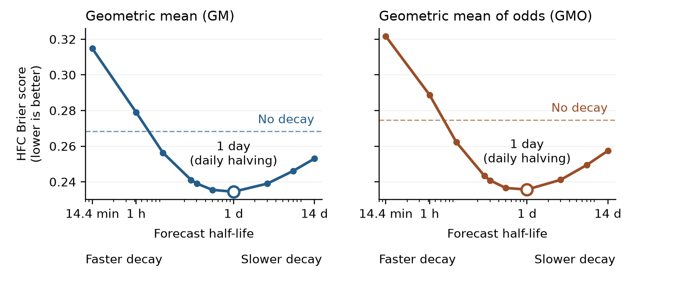

# Forecast aggregation in HFC RCT-A

Which way of combining many people's probability forecasts is most accurate, and can
giving newer forecasts more weight improve it? This study compares five aggregation
methods on the first year (RCT-A) of IARPA's Hybrid Forecasting Competition, then tests
age-weighted versions that use only forecasts available by the previous day.

**Read the [memo](docs/memo.pdf)** (3 pages) and the [technical supplement](docs/supplement.pdf)
(2 pages). Editable sources are in `docs/`.

## Results

Average HFC Brier score over 187 resolved questions, each question weighted equally
(lower is better). All methods use the previous day's information cutoff.

| Method | Score |
| --- | ---: |
| Arithmetic mean | 0.2917 |
| Median | 0.2853 |
| Trimmed mean (10% each side) | 0.2825 |
| Geometric mean of odds (GMO) | 0.2747 |
| Geometric mean (GM) | 0.2683 |
| Arithmetic mean, daily halving | 0.2485 |
| GMO, daily halving | 0.2357 |
| GM, daily halving | 0.2345 |

Halving each forecast's weight for every day of age reduced error by 12.6% (GM),
14.2% (GMO) and 14.8% (arithmetic mean).



## Running it

The data is public: [HFC on Harvard Dataverse](https://doi.org/10.7910/DVN/S0K6TV). Download
`rct-a-questions-answers.csv` and `rct-a-prediction-sets.csv` (the original CSVs, not the
`.tab` versions) into `data/raw/`. Then:

```sh
pip install -r requirements.txt
python analysis.py
```

It takes about half a minute and writes `results.txt`, `daily_forecasts.csv` and
`decay-comparison.png` next to the script. To read the data from elsewhere, change
`RAW_DIRECTORY` on the script's first line.

## Files

| Path | Contents |
| --- | --- |
| `analysis.py` | The whole analysis: cleaning, the five methods, scoring, age weights, report and figure |
| `results.txt` | Full output of the last run, including the tables in the memo and supplement |
| `decay-comparison.png` | The memo's figure |
| `docs/` | Memo and supplement, as PDF and Word |
| `data/ReadMe_hfc.txt` | The dataset's own description of its files |
